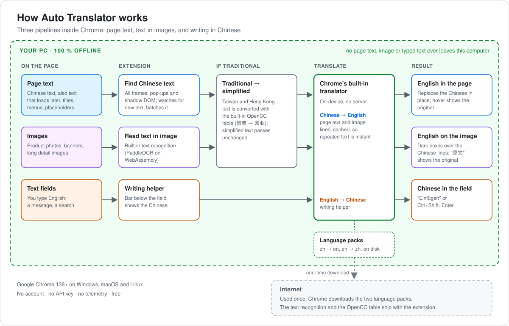

# AutoTranslator

[](https://github.com/MasterBro07/Automatic-Web-Translator-claude/actions/workflows/build.yml?query=branch%3Amain)


[](LICENSE)

**AutoTranslator translates Chinese text on your screen into English, automatically and without a single click.**
It works in Chrome and in ordinary Windows programs (shop apps, chat apps, games, installers) by drawing the
English translation directly on top of the Chinese original.

**Everything runs on your own computer.** Translation uses the translator built into Google Chrome,
text recognition uses the one built into Windows, and the two parts talk to each other only inside your PC.
No account, no API key, no subscription, and no screen text is ever uploaded.

*Deutsche Anleitung: [README.de.md](README.de.md)*



---

## Contents

- [Why offline matters](#why-offline-matters)
- [What you get](#what-you-get)
- [Requirements](#requirements)
- [Installation tutorial](#installation-tutorial)
- [Everyday use](#everyday-use)
- [Troubleshooting](#troubleshooting)
- [Known limits](#known-limits)
- [How it works](#how-it-works)
- [For developers](#for-developers)

---

## Why offline matters

Shop apps, chats and order pages are full of personal data: names, addresses, messages, order numbers.
Online translators send all of that to a server. AutoTranslator does not.

| Part | Where it runs | Uses the internet? |
|---|---|---|
| Reading text on screen (OCR) | Windows' built-in text recognition | **No** |
| Translating Chinese → English | Chrome's built-in on-device translator | **No**, after a one-time language pack download |
| App ↔ Chrome extension | WebSocket on `127.0.0.1` (your own PC) | **No**, only accepts the Chrome extension |
| Settings and translation cache | Files in `%AppData%\AutoTranslator` | **No** |
| Telemetry, accounts, API keys | none | — |

The only download is the Chinese → English language pack, which Chrome fetches once from Google when you
click **"Sprachpaket laden"**. After that you can unplug the network cable and translation keeps working.

## What you get

- **No clicks.** Chinese text is translated the moment it appears and keeps being translated while you
  scroll, chat or browse.
- **Websites:** the Chrome extension replaces Chinese text on the page itself, including text loaded later
  (infinite scroll, pop-ups, chats), iframes, drop-down menus and image captions. Input fields and passwords
  are never touched.
- **Windows programs:** the desktop app reads the active window and draws the English text on a transparent
  layer over the original. Clicks go straight through to the program underneath.
- **Fast:** in tests, new text was translated and shown about 0.5 s after it appeared.
- **Light:** a small tray icon next to the clock; when the screen does not change, it does almost nothing.
- **Free** for personal use, with public source code.

> The user interface of the app and the extension is in German. Translation direction is Chinese → English.

## Requirements

- Windows 10 (version 2004 or newer) or Windows 11, 64-bit
- Google Chrome 138 or newer on the same PC
- About 10 minutes for the one-time setup

## Installation tutorial

### Step 1 – Download

1. Open the [**latest release**](https://github.com/MasterBro07/Automatic-Web-Translator-claude/releases/latest)
   and download both ZIP files:
   - `AutoTranslator-windows-x64.zip`: the Windows app
   - `AutoTranslator-chrome-extension.zip`: the Chrome extension

   *No release yet?* Use the newest green run of the
   [**Build** workflow](https://github.com/MasterBro07/Automatic-Web-Translator-claude/actions/workflows/build.yml?query=branch%3Amain)
   instead and download the two **Artifacts** at the bottom (requires a GitHub sign-in).
2. Unzip both (right-click → **Extract All…**) to a permanent place, for example
   `C:\AutoTranslator\app` and `C:\AutoTranslator\extension`. Do not delete or move these folders later.

### Step 2 – Install the Chrome extension

1. In Chrome, type `chrome://extensions` into the address bar and press Enter.
2. Turn on **Developer mode** (switch in the top right corner).
3. Click **Load unpacked** and select the `extension` folder.
4. A welcome page opens. Click **"Sprachpaket laden"** (download language pack) and wait until the status
   says **"bereit"** (ready). This is the only time anything is downloaded.

Websites in Chrome are now translated automatically. Tabs that were already open need one reload.

### Step 3 – Add Chinese text recognition to Windows

Windows needs its Chinese OCR component to read Chinese characters on screen. Choose one way:

- **Settings:** Settings → Time & language → Language & region → **Add a language** →
  **Chinese (Simplified)**. You do not need to change your Windows display language.
- **Command:** right-click the Start button → **Terminal (Admin)** and run

  ```powershell
  Add-WindowsCapability -Online -Name "Language.OCR~~~zh-CN~0.0.1.0"
  ```

### Step 4 – Start the app

1. Double-click `AutoTranslator.exe` in the `app` folder.
2. If Windows shows **"Windows protected your PC"**, click **More info** → **Run anyway**. The warning
   appears because the app is not code-signed.
3. The app now sits as a round blue **A** icon in the notification area next to the clock (maybe hidden
   behind the `^` arrow). On the first start a help window shows whether the extension and text recognition
   are ready.

**Done.** Open any program or website with Chinese text: the English translation appears on top of it.

> **Tip:** to start AutoTranslator with Windows, press `Win + R`, type `shell:startup`, press Enter and put a
> shortcut to `AutoTranslator.exe` into that folder.

## Everyday use

| Action | How |
|---|---|
| Turn translation on / off | **Ctrl + Alt + T**, or right-click the tray icon → *Übersetzung aktiv* |
| Choose how text is read | Tray menu → *Texterkennung*: **OCR** (reads everything visible, default), **UI-Automation** (reads text straight from the program, very exact but not supported everywhere), or **Beides** (both) |
| Choose what is read | Tray menu → *Bereich*: **Aktives Fenster** (active window, faster) or **Ganzer Hauptbildschirm** (whole primary screen) |
| Translate paragraphs as a whole | Tray menu → *Zeilen zu Absätzen zusammenfassen* (on by default; turn off for lists with many short entries) |
| Pause websites in Chrome | Click the extension icon → untick *Webseiten automatisch übersetzen*, or disable it for one site only |
| See status and setup help | Tray menu → *Einrichtung / Hilfe…* (or double-click the tray icon) |
| Quit | Tray menu → *Beenden* |

Chrome has to be open while you translate, because the app uses Chrome's translator. It can stay minimized.

## Troubleshooting

| Problem | Fix |
|---|---|
| Status says **"Chrome-Erweiterung nicht verbunden"** | Open Chrome and check that the extension is enabled on `chrome://extensions`. |
| Extension popup says **"Sprachpaket fehlt"** | Click **"Sprachpaket laden"** in the popup and wait until it says *bereit*. |
| Help window says the **Chinese OCR is missing** | Do step 3, then quit and restart AutoTranslator. |
| **"AutoTranslator läuft bereits"** | The app is already running; look for the icon next to the clock. |
| Small text is not translated | Very small fonts (about 12 px) are hard to read for OCR. Zoom in (Ctrl + Plus) or try *UI-Automation*. |
| Ctrl + Alt + T does nothing | Another program uses that shortcut; use the tray menu instead. The help window shows this too. |
| Something else | Send the file `%AppData%\AutoTranslator\log.txt` (paste that path into the Explorer address bar). |

## Known limits

- Translation direction is Chinese → English only.
- OCR is not perfect: very small text, decorative fonts and busy backgrounds can cause mistakes.
- Exclusive full-screen games and copy-protected video cannot be captured by any screen reader.
- The translation shows up about half a second after the text; while scrolling it briefly lags behind.
- Tested automatically on Windows Server 2022 and 2025 (1 monitor, 100 % scaling). Several monitors with
  different scaling were not tested.

## How it works

1. **Capture:** every 0.7 s the app grabs the active window. If nothing changed, the cycle stops here.
2. **Recognise:** Windows OCR finds Chinese lines and their exact positions.
3. **Filter & cache:** only lines with Chinese characters are kept, wrapped lines are joined into paragraphs,
   and anything translated before comes straight from the local cache.
4. **Translate:** new text goes over a local WebSocket (`127.0.0.1:47613`) to the Chrome extension, which
   translates it with Chrome's built-in on-device Translator API.
5. **Overlay:** the app draws the English text over the original in a transparent, click-through window that
   is hidden from its own screen capture, so it never re-reads its own translations.

On websites the extension does the same job inside the page: it finds Chinese text, translates it on-device
and replaces it in place, and a watcher picks up anything added later.

The local connection only accepts Chrome extensions (`chrome-extension://` origin); websites cannot connect.

## For developers

| Path | Contents |
|---|---|
| `src/AutoTranslator.Core` | Platform-independent logic: bridge server, pipeline, cache, line merging (.NET 8) |
| `src/AutoTranslator.App` | WPF tray app: screen capture, Windows OCR, UI Automation, overlay |
| `extension/` | Chrome MV3 extension, plain JavaScript, no build step |
| `tests/` | xUnit tests for Core and Windows smoke tests for the real app |
| `extension-tests/` | Playwright tests for the extension |

- Build: GitHub Actions ([`build.yml`](.github/workflows/build.yml)) runs the tests and publishes a
  self-contained `AutoTranslator.exe` plus the extension as artifacts.
- Release: run the [`Release`](.github/workflows/release.yml) workflow by hand (Actions → Release →
  *Run workflow*); it builds both parts and publishes them as ZIP files on a new GitHub Release.
- Core tests run on any OS: `dotnet test tests/AutoTranslator.Core.Tests`
- Extension tests: `npm i playwright ws && node extension-tests/run.js`
- Architecture and the bridge protocol: [docs/ARCHITECTURE.md](docs/ARCHITECTURE.md)

## License

[PolyForm Strict 1.0.0](LICENSE). In short:

- **Allowed:** free use for **personal and other noncommercial purposes** (private use, study, hobby,
  charities, schools, public institutions).
- **Not allowed:** commercial use, **redistributing** the software (please link to this repository
  instead of re-uploading it), and publishing changed versions or new works based on it.

The source code is public so you can see what the program does, but this is not an open-source license.
For commercial use or any other permission, please ask the author.
